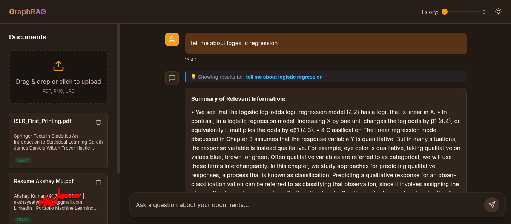
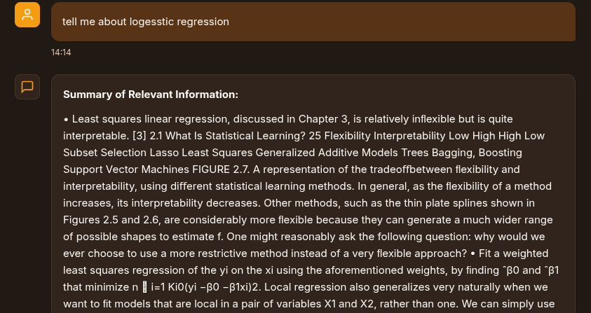

# Multimodal GraphRAG — Production Retrieval-Augmented Generation

A production-grade Retrieval-Augmented Generation (RAG) system combining **dense/sparse hybrid search**, **adaptive document-scale chunking**, **hierarchical section breadcrumbs**, **knowledge graph expansion**, and **cross-encoder re-ranking** to deliver grounded, hallucination-free answers from dense technical books, research papers, resumes, and complex documents.

## Interface & Prompt Compression Comparison

| Baseline Hybrid RAG (Uncompressed Context) | With LongLLMLingua Question-Aware Compression |
|:------------------------------------------:|:---------------------------------------------:|
|  |  |

### Key Differences Observed

1. **Context Density & Information Filtering**:
   - **Baseline (Standard RAG)**: Passes raw, uncompressed retrieved chunks verbatim into the generation prompt. As shown in the baseline screenshot, responses often pull surrounding introductory narrative (e.g. conversational textbook explanations like *"eye color is qualitative, taking on values blue, brown, or green..."*).
   - **With LongLLMLingua**: Uses question-conditioned perplexity scoring to aggressively prune low-information tokens, retaining high-yield mathematical expressions, core trade-offs (e.g. flexibility vs. interpretability across models), and essential formulas.

2. **Token Efficiency & Downstream Cost Savings**:
   - Compresses retrieved context by **~30%–40% (1.5x–1.7x compression ratio)** without sacrificing semantic recall or factual grounding.
   - Lowers prompt token consumption for downstream cloud or local LLM generation.

3. **Context Reordering & Lost-in-the-Middle Mitigation**:
   - Standard retrieval orders strictly by reranker score, often burying key details in the middle of long multi-chunk prompts.
   - LongLLMLingua dynamically sorts and distributes highest-density chunks toward prompt boundaries where attention is strongest.

---

## Key Features

- 🎯 **Adaptive Document-Scale Chunking**: Dynamically adjusts target chunk sizes based on document scale (Books: 1800c, Reports: 1200c, Resumes: 650c).
- 🗜️ **LongLLMLingua Question-Aware Prompt Compression**: Compresses retrieved contexts using open-source language models (default: `gpt2`, configurable to `Qwen/Qwen2.5-0.5B`, `microsoft/phi-2`). Dynamically reorders contexts to mitigate "lost-in-the-middle" degradation and cuts prompt token footprint while preserving essential entities.
- 🚫 **Front-Matter & Back-Matter Noise Exclusion**: Automatically classifies page roles (`BODY`, `TOC`, `INDEX`). Excludes TOC and Index listing pages from semantic vector indexing so page numbers/index listings never hijack queries.
- 📌 **Hierarchical Section Breadcrumbs**: Extracts Chapter, Section, and Subsection headers (e.g. `[Section: Chapter 4: Classification > 4.3 Logistic Regression]`) and prepends structural context to every chunk.
- 🔍 **Query Typo Auto-Correction**: Normalizes user typos (e.g. `logestic` $\rightarrow$ `logistic`) and displays a UI suggestion badge (`💡 Showing results for: "tell me about logistic regression"`).
- ⚡ **Response Latency & Compression Tracking**: Tracks total pipeline processing time in milliseconds (`⚡ XXX ms`) and compression ratio (`🗜️ 2.1x`) next to assistant responses.
- 🛠️ **Unified Management CLI (`manage.py`)**: One command (`python manage.py reindex`) to automatically purge and re-chunk all uploaded documents.

---

## Technology Stack

| Component | Technology | Notes |
|-----------|------------|-------|
| **API Server** | Flask + Flask-CORS | Sync server with ThreadPoolExecutor for async tasks |
| **CLI Manager** | `manage.py` | Unified management CLI for re-indexing, server, status, tests |
| **Task Queue** | Celery + Redis | Asynchronous background ingestion; falls back to ThreadPool |
| **Vector DB** | Qdrant | Local file-backed storage with dense and sparse named vectors |
| **Graph Store** | SQLite / Neo4j | Local SQLite graph store by default; Neo4j optional via env |
| **Metadata DB** | SQLite via aiosqlite | Document records, chunk counts, ingestion progress state |
| **Prompt Compressor** | LongLLMLingua (`llmlingua`) | Question-aware compression and context reordering using open-source models |
| **Dense Vectors** | `all-MiniLM-L6-v2` | Local 384-dimensional sentence transformer embeddings |
| **Sparse Vectors**| BM25 + MD5 Hashing | Token-frequency feature vectors stored in Qdrant sparse index |
| **Re-ranker** | `ms-marco-MiniLM-L-6-v2` | Cross-encoder passage re-ranking model |
| **Fusion** | Reciprocal Rank Fusion | RRF ($k=60$) combining dense ANN search and sparse BM25 |
| **PDF Parsing** | PyMuPDF (fitz) + Tesseract | Extract text with Tesseract OCR fallback for scanned pages |

---

## Quick Start & Usage

### 1. Unified Management CLI (`manage.py`)

```bash
# Re-index all uploaded documents using the adaptive structure-aware pipeline
python manage.py reindex

# Start the Flask backend web server
python manage.py run

# Display system status (documents, page counts, Qdrant vectors)
python manage.py status

# Run backend unit and integration test suite
python manage.py test
```

### 2. Launching the Web Interface
Start the backend server with `python manage.py run` and open **http://127.0.0.1:5000** in your browser to interact with the web interface.
